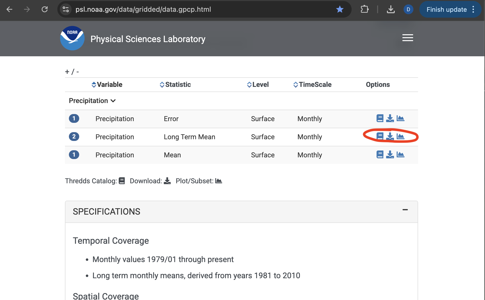
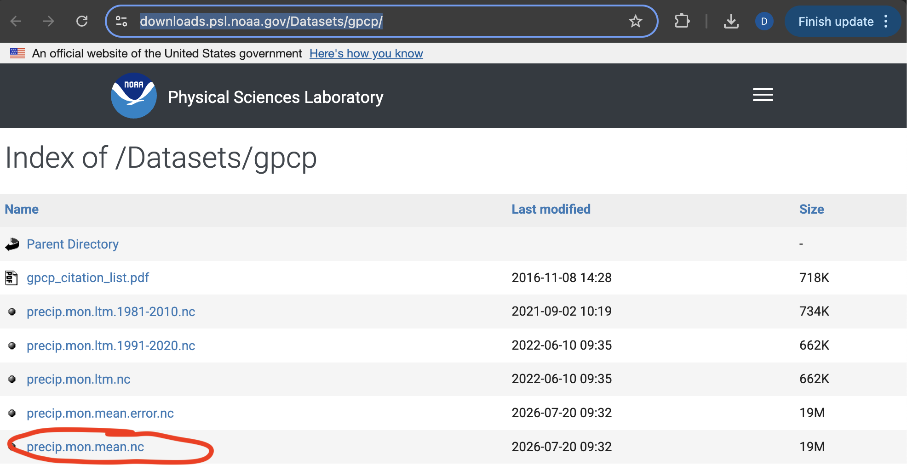

This file was downloaded on 10/20/26 9:02 PM EST from
https://downloads.psl.noaa.gov/Datasets/gpcp/

Home page: https://psl.noaa.gov/data/gridded/data.gpcp.html

Specifications
Temporal Coverage
Monthly values 1979/01 through present
Long term monthly means, derived from years 1981 to 2010

Spatial Coverage
2.5 degree latitude x 2.5 degree longitude global grid (144x72)
88.75N - 88.75S, 1.25E - 358.75

Levels
Surface

Update Schedule
Monthly

Dataset Format and Size
CF metadata standard, NetCDF4 format.

Missing Data
Missing data is flagged with a value of -9.96921e+36f.

The GPCP Monthly product provides a consistent analysis of global precipitation from an integration of various satellite data sets over land and ocean and a gauge analysis over land. Data from rain gauge stations, satellites, and sounding observations have been merged to estimate monthly rainfall on a 2.5-degree global grid from 1979 to the present. The careful combination of satellite-based rainfall estimates provides the most complete analysis of rainfall available to date over the global oceans, and adds necessary spatial detail to the rainfall analyses over land. In addition to the combination of these data sets, estimates of the uncertainties in the rainfall analysis are provided as a part of the GPCP products.

Note that some data at the end of the dataset may be interim. There is a netCDF attribute that has the first month of the interim data.
